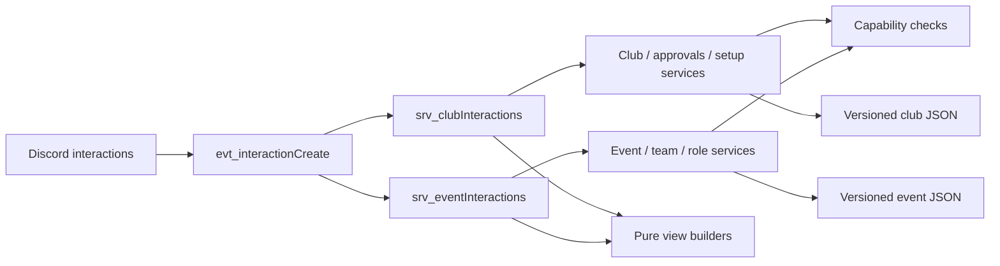

# Architecture — Club Management Core

The supported runtime is one Node process using ES modules and discord.js v14.
No web server, build, new package, or external database is needed.

Handlers parse untrusted component values, use the authenticated guild member,
check relevant capabilities, acknowledge before slow work, call services, and
render view models. Modal-opening actions call `showModal` immediately. Components
on public messages use ephemeral replies; private navigation uses deferred updates.
User-facing payloads disable mention parsing and bound escaped display text.

Services recheck current Discord membership and trusted role-ID configuration at
mutation time. Membership/approval work shares a serialized club-store transaction.
Event work locks by store/guild/event across provisioning, roster changes, edits,
repair, and cleanup. Storage modules validate and atomically replace snapshots;
UI modules never perform Discord mutations or storage queries.

Club authorization and CORE channel policy are separate. Department Co-Managers
can resolve joins to their department but transfers and leadership need club-wide
authority. No editable profile field authorizes a user. See [PERMISSIONS.md](PERMISSIONS.md).

UI sessions and confirmation previews are transient, scoped to actor and guild,
and expire after 15 minutes. They retain search and selected roster context while
keeping custom IDs bounded. A process restart invalidates those previews: return
Home and open a new screen. Durable operations live in JSON, not these sessions.

The existing event data/UI exports remain available for compatibility. Live
interactions route through the scoped service views; obsolete mutation controls
show a return path instead of bypassing new authorization. Every live mutation
requires guild context. Event service calls accept a context containing `guild`,
`actor`, and optional injected `store`; club service factories own their injected
stores and ignore caller-supplied role configuration.

Runtime data cannot be shared by multiple bot processes or edited externally while
running. Atomic files prevent partial JSON replacements, but Discord and a local
file are not a distributed transaction. Prepared operation records and compensation
support diagnosis and confirmed repair after interruptions. See [DATA_MODEL.md](DATA_MODEL.md).
